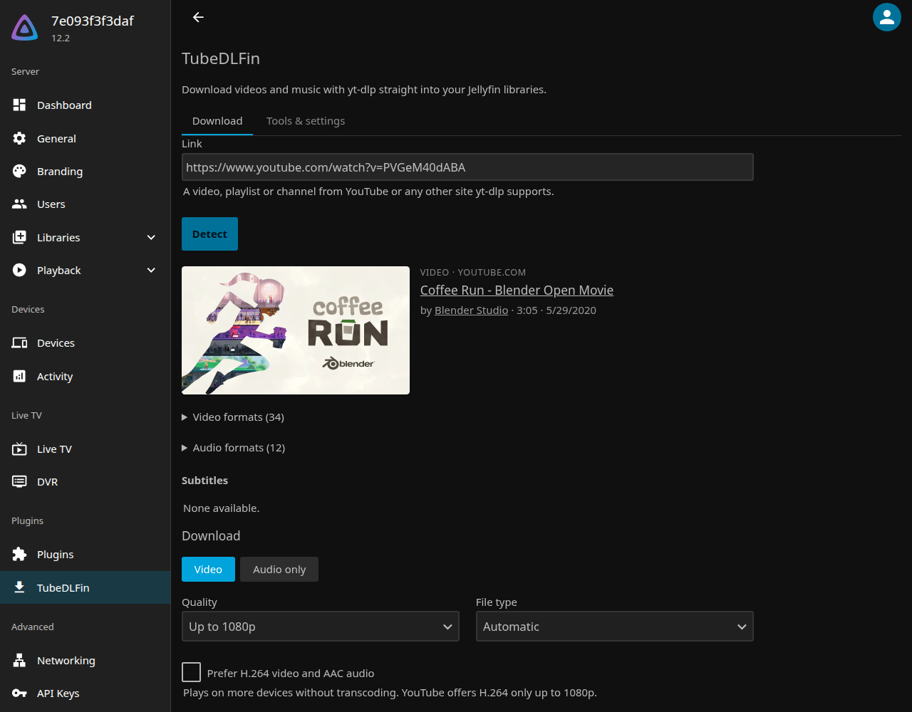
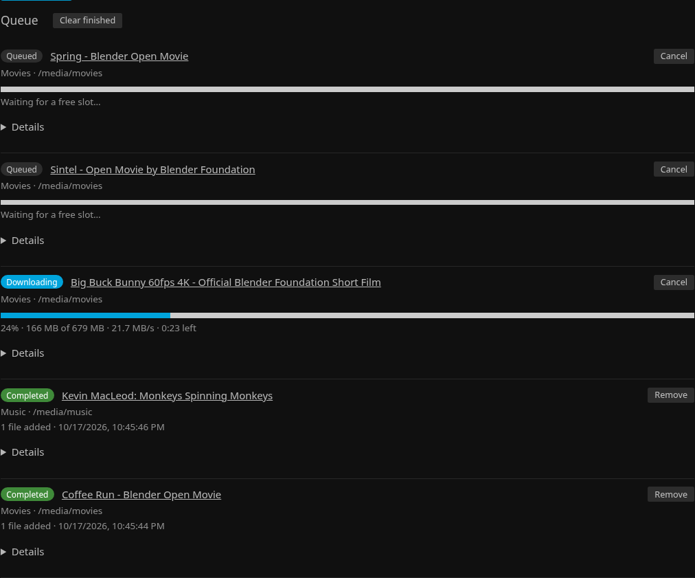
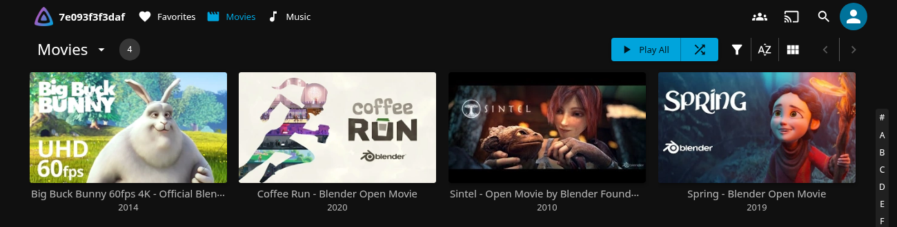

# TubeDLFin

**Tube** + **DL** + Jelly**fin**: a Jellyfin plugin that brings a [yt-dlp](https://github.com/yt-dlp/yt-dlp)
download workflow into the Jellyfin dashboard. Paste a video, playlist or channel link, see
what is available, pick the options, and TubeDLFin downloads it straight into one of your
libraries, named and tagged so Jellyfin shows it properly.

> Development happens on GitLab: [gitlab.com/wqyeo/jellyfin-plugin-tubedlfin](https://gitlab.com/wqyeo/jellyfin-plugin-tubedlfin).
> [github.com/wqyeo/TubeDLFin](https://github.com/wqyeo/TubeDLFin) is a read-only mirror:
> please open issues and merge requests on GitLab.



- Jellyfin **12.2** (`targetAbi 12.2.0.0`) on Linux (x64, arm64 such as a Raspberry Pi), Windows or macOS
- Works for both **video** and **music** libraries
- yt-dlp and Deno are downloaded, verified and kept up to date by the plugin; FFmpeg comes from Jellyfin
- Admins only: the page and its API are limited to Jellyfin administrators

## Features

- **Detect** any link yt-dlp supports: formats, subtitles, music tags, playlist and channel items.
- **Video** up to 2160p or a specific format (MP4, MKV, WebM, prefer H.264), or **audio only**
  (original, M4A, MP3, Opus, FLAC, WAV).
- **Layouts that match the library type**, chosen automatically:

  | Library | Files |
  |---|---|
  | Movies | `Title [id]/Title [id].mp4` + `.nfo` + `poster.jpg` |
  | Shows | `Channel/Season 2026/Channel - S2026E10171435 - Title [id].mp4`: one season per year, episodes by upload date and time |
  | Music Videos | `Artist/Title [id].mp4` |
  | Music | `Album artist/Album/01 - Title.m4a`, tracks without an album in `Artist/Singles/` |
  | Home Videos, Mixed | `Channel/Title [id].mp4` + `.nfo` + `Title [id]-poster.jpg` |

  Or "Channel / Title", "Playlist / 01 - Title", or your own yt-dlp output template.
- **Metadata Jellyfin reads**: `.nfo` files with the original title, description, date and
  channel (locked, so Jellyfin doesn't replace them with a wrong online match), the thumbnail
  as poster, embedded tags, chapters and cover art.
- **Music tags**: "Artist - Title" titles are split, "(Official Video)" and similar are
  removed, YouTube's " - Topic" is dropped, playlists are numbered, YouTube Music albums keep
  their album and year, a playlist can become one album, and cover art is cropped square.
- **Subtitles** as `.srt` files (uploaded or auto-generated), with the language Jellyfin expects.
- **SponsorBlock**: cut out or mark sponsor segments, intros, outros and more.
- **Queue** with progress, speed, cancel and a log per download. Each library keeps an archive,
  so nothing is downloaded into it twice.
- **Subscriptions**: follow a channel or playlist and its new uploads are downloaded
  automatically, on a schedule you choose.



## Install

1. In Jellyfin, open **Dashboard → Plugins → Manage Repositories → New Repository** and add:
   - Name: `TubeDLFin`
   - URL: `https://wqyeo.gitlab.io/jellyfin-plugin-tubedlfin/manifest.json`
2. Back on **Plugins**, choose **Available**, open **TubeDLFin** and press **Install**.
3. Restart Jellyfin (**Dashboard → Restart**, or restart the container).
4. **TubeDLFin** now appears in the dashboard's sidebar. On first start it downloads yt-dlp and
   Deno (a minute or so); their status is under **Tools & settings**.

TubeDLFin writes into your library folders, which media setups often mount read-only. Read
the next section before the first download.

### Docker

Jellyfin must be able to **write** to the library folders:

- Don't mount them read-only (`:ro`).
- The user Jellyfin runs as must own the folders, or be allowed to write to them:
  - official `jellyfin/jellyfin` image: the user given by `--user` / `user:` (root if none);
  - linuxserver.io image: `PUID` / `PGID`.

```yaml
services:
  jellyfin:
    image: jellyfin/jellyfin:12.2
    user: 1000:1000                  # owner of /srv/media (see `ls -ln /srv/media`)
    volumes:
      - ./config:/config
      - ./cache:/cache
      - /srv/media:/media            # read-write, no ":ro"
    ports:
      - 8096:8096
    restart: unless-stopped
```

The plugin keeps yt-dlp, Deno, the download archives and temporary files in Jellyfin's data
folder (`/config/data/tubedlfin` in Docker, `/var/lib/jellyfin/data/tubedlfin` for the Linux
packages), so they survive container updates. Partial downloads stay there until finished, so
the data folder needs room for the largest video you download.

Alpine-based (musl) images: yt-dlp works, but Deno has no musl build, so YouTube may lack some
formats. Install Deno in the image and set its path under **Tools & settings**.

### Cookies (YouTube "sign in to confirm you're not a bot")

YouTube often blocks servers, especially on VPS and data-centre addresses, and sometimes home
connections after many downloads. Age-restricted and members-only videos need a signed-in
account too. Give yt-dlp a browser's cookies:

1. In a private browser window, sign in to YouTube (a spare account is safer: YouTube may
   limit accounts that download a lot).
2. In the same window, export the cookies in Netscape `cookies.txt` format with a browser
   extension such as "Get cookies.txt LOCALLY". Then close the private window without signing
   out, so the cookies stay valid (see yt-dlp's
   [FAQ](https://github.com/yt-dlp/yt-dlp/wiki/Extractors#exporting-youtube-cookies)).
3. Copy the file to the server where Jellyfin can read and write it, for example
   `/config/data/tubedlfin/cookies.txt` (in Docker, inside the `config` volume).
4. Enter that path under **Tools & settings → Cookies file** and save.

yt-dlp writes refreshed cookies back to the file. The cookies give access to your account,
so keep the file private.

### Beta versions

New features go out as betas first. To try them, add a second repository next to the first:

- Name: `TubeDLFin beta`
- URL: `https://wqyeo.gitlab.io/jellyfin-plugin-tubedlfin/manifest-beta.json`

Jellyfin then offers the newest version, beta or not: update TubeDLFin under **Available** and
restart. A beta's changelog in the catalog starts with "Beta". When the stable release comes
out, the server updates to it like any other version. To stop getting betas, remove that
repository; the beta stays installed until the next stable version replaces it.

## Usage

1. Open **TubeDLFin** in the dashboard and paste a link on the **Download** tab.
2. **Detect** shows what the link points to. For a playlist or channel, pick the items; for a
   video inside a playlist, choose the video or the whole playlist.
3. Choose **Video** or **Audio only**, the quality, and the library. The library decides the
   defaults:
   - **Music library** → audio only, M4A (YouTube's AAC stream, no re-encoding), the
     "Artist / Album / 01 - Title" layout, music tags and embedded square cover.
   - **Video libraries** → best video up to the chosen height, the layout for the library type,
     `.nfo` files and posters. The **Music tags** group also applies to Music Videos libraries.

   The page remembers your last options, separately for music and video.
4. **Download**. The queue shows progress, and new items appear in Jellyfin within seconds.
   A finished job's **Details** shows its files and yt-dlp's log.



### Subscriptions

To download a channel's or playlist's new uploads automatically:

1. Detect the channel or playlist on the **Download** tab and choose **Subscribe** (instead of
   **Download now**).
2. Pick a name and how often to check (every hour to every week).
3. Set the options as for a download. A **Shows** library with the "TV show" layout works well:
   each channel becomes a show with one season per year.
4. Press **Subscribe**.

Only uploads from then on are downloaded. To get the videos it has now too, tick **Also
download the videos it has now**: they are queued at once, all of them or the **Items** you
enter (a channel lists its newest first, so `1-20` is its latest 20). For a playlist, "new"
means added to the playlist after subscribing. The archive keeps anything from being
downloaded twice.

The **Subscriptions** tab shows when each was last and will next be checked, how many uploads
were downloaded, and any problem. **Check now** looks for new uploads straight away. The checks
run as the scheduled task "Check subscriptions" (every 15 minutes, under Dashboard → Scheduled
Tasks); each subscription is only checked when its own interval is up.

- New uploads go through the normal queue, at most 10 per check; the rest come with the next checks.
- A failed upload (a premiere that hasn't started, a temporary 403) is tried again on the next
  checks, 3 times in all.
- For a YouTube channel, its Videos tab is checked; Shorts and live streams are not, unless you
  subscribe to the `/shorts` or `/streams` link.
- Changing a subscription's download options isn't possible on the page yet: delete it and
  subscribe again (nothing already downloaded is downloaded again).
- Subscriptions are saved in `subscriptions.json` in the data folder (see [Docker](#docker)).
  Deleting one keeps its files.

Checking many channels often can make YouTube limit the server; a cookies file helps.

## Troubleshooting

| Problem | What to do |
|---|---|
| "Sign in to confirm you're not a bot" | Set a [cookies file](#cookies-youtube-sign-in-to-confirm-youre-not-a-bot) |
| "Read-only file system" | The folder is mounted read-only for Jellyfin. Docker: remove `:ro` from the volume ([Docker](#docker)). Linux packages: if the `jellyfin` service is sandboxed (`systemctl cat jellyfin` shows `ProtectSystem=`), add `ReadWritePaths=/your/media` with `systemctl edit jellyfin`. Otherwise the drive itself is read-only: check `findmnt -T /your/media` and `dmesg` (external NTFS/exFAT drives often mount read-only after being unplugged without ejecting) |
| "Permission denied" | The user Jellyfin runs as can't write to the folder: check its owner (`ls -ld`), and `user:` / `PUID`/`PGID` in Docker |
| HTTP 403 or 429 | The site is limiting this server. Wait a while; cookies help with YouTube |
| yt-dlp or Deno "not ready" | **Tools & settings → Update now**, and check Jellyfin's log. The server needs access to `github.com` |
| Formats missing or "Requested format is not available" | Update yt-dlp (it is updated daily; sites change often). Check that Deno shows as ready |
| A subscription shows a problem | Its last error says why. "Choose a library": the library was removed, so delete the subscription and subscribe again. Site errors are retried at the next check |
| A download isn't in Jellyfin | Check it was saved into a folder of that library, and that the library type matches (music into a Music library) |
| Anything else | Open the job's **Details** and include the log in a [bug report](https://gitlab.com/wqyeo/jellyfin-plugin-tubedlfin/-/issues/new?issuable_template=Bug) |

Extra yt-dlp options (for example `--limit-rate 5M`) can be set under **Tools & settings**.

## Legal

Screenshots show Blender Studio's open movies ([CC BY](https://studio.blender.org/films/)).

TubeDLFin is not affiliated with YouTube, Google, the yt-dlp project or Jellyfin. You are
responsible for what you download: respect the terms of the sites you use and copyright law,
and only download what you have the right to keep.

TubeDLFin itself contains no download code for any site. It runs
[yt-dlp](https://github.com/yt-dlp/yt-dlp) (Unlicense) and [Deno](https://deno.com) (MIT),
which it downloads from their official GitHub releases and checks against their published
SHA-256 checksums.

## Development

Requirements: .NET SDK 10.0.400+, Node 24+, podman (or Docker). With [mise](https://mise.jdx.dev),
`mise install` sets these up (except podman).

```sh
dotnet build                # also builds web/ (npm ci + esbuild) the first time
dotnet test

cd web && npm run check     # TypeScript type check + Biome lint + unit tests

dev/jellyfin.sh deploy      # build, install into a local Jellyfin 12.2, (re)start it
dev/jellyfin.sh logs        # http://127.0.0.1:8096
dev/jellyfin.sh down
```

Layout:

| Path | What |
|---|---|
| `src/Jellyfin.Plugin.TubeDLFin/` | The plugin (C#). `PluginServiceRegistrator` is the composition root |
| `web/` | The dashboard page (TypeScript, bundled by esbuild into `web/dist/`, embedded in the DLL) |
| `web/release/` | Release scripts: plugin repository manifest and release notes |
| `tests/Jellyfin.Plugin.TubeDLFin.Tests/` | xUnit v3 tests |
| `build.yaml` | Plugin metadata for [JPRM](https://github.com/oddstr13/jellyfin-plugin-repository-manager) packaging |
| `dev/` | Local Jellyfin container script |
| `docs/` | Tech stack, [releasing](docs/RELEASING.md), images |

Changes are listed in [CHANGELOG.md](CHANGELOG.md).

## Licence

[MIT](LICENSE)
